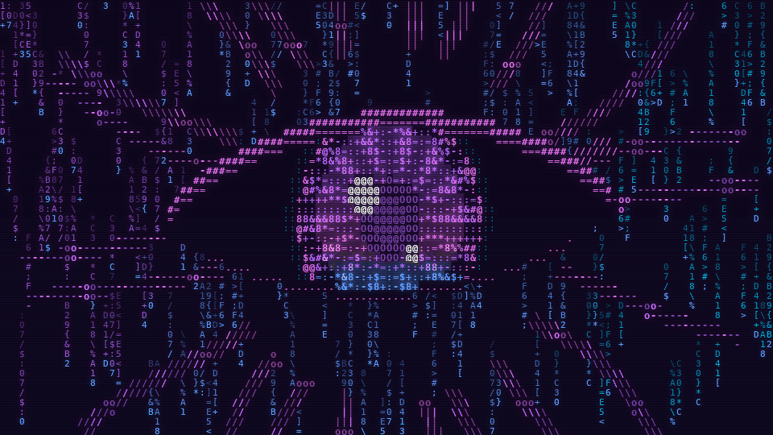

<p align="center">
  
</p>

<p align="center">
  <a href="https://github.com/tmege">
    
  </a>
</p>

<p align="center">
  
  
  
</p>

<br>

### `▓▒░` &nbsp;what i build

<table>
  <tr>
    <td width="50%" valign="top">
      <h4>◈ Business Management System</h4>
      <sub><code>private</code></sub>
      <p>Finance, customers, inventory and projects in one place, built and maintained by a hierarchy of AI agents (CEO → managers → specialists).</p>
      
      
    </td>
    <td width="50%" valign="top">
      <h4>◈ <a href="https://github.com/tmege/LatestTechNews">LatestTechNews</a></h4>
      <sub><code>cron pipeline</code></sub>
      <p>Pulls 22 RSS feeds daily, filters spam and duplicates, ranks and summarizes articles with an LLM, then posts them to Discord.</p>
      
      
    </td>
  </tr>
  <tr>
    <td width="50%" valign="top">
      <h4>◈ <a href="https://github.com/tmege/artist-metrics">artist-metrics</a></h4>
      <sub><code>dashboard</code></sub>
      <p>One dashboard for an artist's numbers across YouTube, Instagram, TikTok, Spotify, Deezer and Apple Music. OAuth, 6-hourly sync, encrypted tokens.</p>
      
      
    </td>
    <td width="50%" valign="top">
      <h4>◈ <a href="https://github.com/tmege/XTTS-Voice-Generator">XTTS-Voice-Generator</a></h4>
      <sub><code>local AI</code></sub>
      <p>Local voice cloning with Hugging Face models.</p>
      
      
    </td>
  </tr>
</table>

<br>

### `▓▒░` &nbsp;from 42

```diff
+ ft_transcendence (NULL//CITY)  multiplayer cybersecurity game · Python · SQLite · scrypt · SSE · Docker over HTTPS
+ ft_irc                         IRC server in C++98 · single poll() loop · non-blocking sockets · no threads
+ Inception                      Docker Compose infrastructure · NGINX secured with TLS
+ minishell · push_swap · C++    RAII · templates · STL · Ford-Johnson sort
```

<br>

### `▓▒░` &nbsp;stack

<p align="center">
  
</p>

<p align="center">
  
  
  
  
  
  
</p>

<p align="center">
  <sub>agent design · prompt engineering · API integrations · OAuth · auth · cron jobs · data pipelines</sub>
</p>

<br>

### `▓▒░` &nbsp;ping me

<p align="center">
  <a href="https://linkedin.com/in/t-mege"></a>
  <a href="mailto:t.p.mege@gmail.com"></a>
</p>


